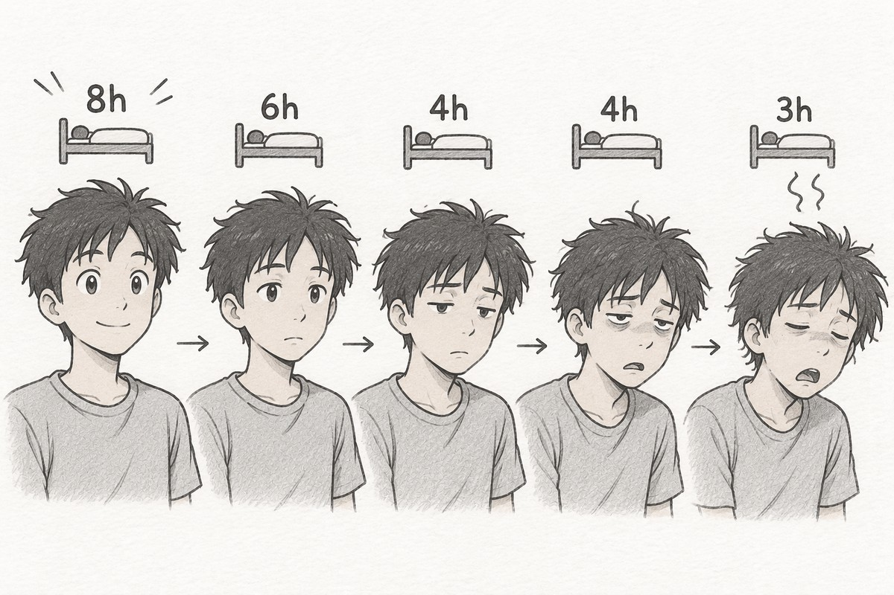

```{r}
#| label: setup
#| include: false

# install.packages(c("tidyverse", "lme4", "here", "patchwork", "performance", "see"))
library(tidyverse)
library(lme4)
library(here)       # rutas desde la raiz del proyecto (exercises.Rproj)
library(patchwork)  # para juntar paneles en las figuras ilustrativas

options(scipen = 999, width = 80)  # emparejado con body-width: 780px
options(pillar.sigfig = 5)  # tibbles con 5 cifras significativas

# Estetica comun de las figuras ilustrativas (solo presentacion)
theme_tut <- theme_classic(base_size = 11) +
  theme(plot.title = element_text(size = 11, face = "bold"),
        plot.title.position = "plot")
```

Este documento es la introducción conceptual a los modelos lineales mixtos, con un ejemplo de medidas repetidas que viene con `lme4`: `sleepstudy`.

```{r}
#| label: intro-sleep
#| include: false

# sleepstudy (Belenky et al., 2003), incluido en lme4: 18 participantes, 10
# dias de privacion de sueno (0 a 9), tiempo medio de reaccion cada dia.
data("sleepstudy", package = "lme4")
sleep <- as_tibble(sleepstudy)

# Los tres modelos de la figura 14.2 de Winter
sleep_model_lm  <- lm(formula = Reaction ~ Days, data = sleep)
sleep_model_intercepts <- lmer(formula = Reaction ~ Days + (1 | Subject), data = sleep)
sleep_model_slopes <- lmer(formula = Reaction ~ Days + (1 + Days | Subject), data = sleep)

# Desviaciones tipicas y correlacion del modelo con pendientes variables
variance_components <- as.data.frame(VarCorr(sleep_model_slopes))
sd_intercepts   <- variance_components$sdcor[variance_components$grp == "Subject" & variance_components$var1 == "(Intercept)" & is.na(variance_components$var2)]
sd_slopes <- variance_components$sdcor[variance_components$grp == "Subject" & variance_components$var1 == "Days" & is.na(variance_components$var2)]
cor_intercept_slope     <- variance_components$sdcor[variance_components$grp == "Subject" & !is.na(variance_components$var2)]
sd_residual   <- variance_components$sdcor[variance_components$grp == "Residual"]
fixed_intercept <- fixef(sleep_model_slopes)[["(Intercept)"]]
fixed_slope <- fixef(sleep_model_slopes)[["Days"]]
n_subjects <- n_distinct(sleep$Subject)

# Tres participantes para la figura 14.1: el de pendiente mas empinada, el de
# pendiente mas plana (o negativa) y, de los demas, el mas rapido de base
subject_coefs <- coef(sleep_model_slopes)$Subject |> rownames_to_column(var = "Subject")
id_steepest <- subject_coefs$Subject[which.max(subject_coefs$Days)]
id_flattest  <- subject_coefs$Subject[which.min(subject_coefs$Days)]
remaining_coefs  <- subject_coefs |> filter(!Subject %in% c(id_steepest, id_flattest))
id_fastest  <- remaining_coefs$Subject[which.min(remaining_coefs$`(Intercept)`)]
three_ids  <- c(id_fastest, id_steepest, id_flattest)
```

# El supuesto de independencia

El Tutorial 1 terminaba en el supuesto más importante del modelo lineal, la independencia, que no se comprueba con un gráfico: **se decide en el diseño**. La pregunta es cuántas medidas aporta cada persona.

```{r}
#| label: intro-independence
#| echo: false
#| fig-width: 8
#| fig-height: 3.4

# La misma figura del Tutorial 1: una medida por persona frente a diez
set.seed(15)
indep_ok  <- tibble(persona = 1:60, y = rnorm(n = 60, mean = 0, sd = 1.6))
person_effect <- c(1.8, -1.2, 0.4, -2.3, 2.6, -0.6)  # nivel propio de cada persona
indep_bad <- expand_grid(persona = 1:6, medida = 1:10) |>
  mutate(y = person_effect[persona] + rnorm(n = 60, sd = 0.4))
plot_indep_ok <- ggplot(data = indep_ok, mapping = aes(x = persona, y = y)) +
  geom_point(size = 1.6, colour = "grey45") +
  scale_y_continuous(limits = c(-4.5, 4.5)) +
  scale_x_continuous(breaks = c(1, 20, 40, 60)) +
  annotate("text", x = 30, y = -4.3, label = "60 datos = 60 personas", size = 3.4) +
  labs(x = "Persona", y = "Respuesta", title = "Cumple: una medida por persona") +
  theme_tut
plot_indep_bad <- ggplot(data = indep_bad, mapping = aes(x = factor(persona), y = y)) +
  geom_jitter(width = 0.15, height = 0, size = 1.6, colour = "grey45") +
  scale_y_continuous(limits = c(-4.5, 4.5)) +
  annotate("text", x = 3.5, y = -4.3, label = "60 datos, pero solo 6 personas", size = 3.4) +
  labs(x = "Persona", y = "Respuesta", title = "No cumple: diez medidas por persona") +
  theme_tut
plot_indep_ok | plot_indep_bad
```

::: {.column-margin}
Una dependencia es cualquier conexión entre dos datos. La más común: medidas repetidas de una misma persona. Las medidas de una misma persona se parecen más entre sí que las de personas distintas, y eso se puede decir con los residuos: si la persona A responde en general más rápido que la persona B, todos los residuos de A van juntos, y todos los de B también.
:::

Si el modelo no sabe de esas dependencias, es como si la muestra fuera mayor de lo que es, y los falsos positivos se disparan muy por encima del 5 %.

## Dependencias cruzadas y anidadas

Las dependencias vienen en dos formas. En un diseño **cruzado** (*crossed*), cada nivel de un factor se combina con cada nivel del otro: cada participante responde a todas las palabras, y cada palabra la ven todos los participantes. Hay dos fuentes de dependencia a la vez, la persona y la palabra. En un diseño **anidado** (*nested*), cada unidad pertenece a una sola unidad mayor: cada cría es de una sola camada, cada paciente de un solo terapeuta, cada alumno de una sola aula.

```{r}
#| label: intro-crossed-nested
#| echo: false
#| fig-width: 8
#| fig-height: 3.6

# Dos esquemas de diseno (solo presentacion). Cruzado: 6 participantes x 4
# palabras (dos frecuentes, dos raras), la misma palabra en todas las filas. Anidado: 4 camadas con 5 crias
# cada una, y cada cria solo en su camada.
crossed <- expand_grid(participante = paste0("P", 1:6),
                       palabra = c("casa", "alf\u00e9izar", "perro", "zozobra")) |>
  mutate(participante = factor(participante, levels = rev(paste0("P", 1:6))),
         palabra = factor(palabra, levels = c("casa", "alf\u00e9izar", "perro", "zozobra")))
plot_crossed <- ggplot(data = crossed, mapping = aes(x = palabra, y = participante)) +
  geom_tile(fill = "grey88", colour = "white", linewidth = 1.2) +
  geom_text(mapping = aes(label = palabra), size = 3, colour = "grey25") +
  scale_x_discrete(position = "top") +
  labs(x = NULL, y = NULL, title = "Cruzado (crossed): participantes x palabras") +
  theme_tut +
  theme(axis.line = element_blank(), axis.ticks = element_blank())

nested <- expand_grid(camada = 1:4, pos = 1:5) |>
  mutate(cria = (camada - 1) * 5 + pos,
         pos = 6 - pos)   # la cria 1 arriba
litter_cells <- tibble(camada = 1:4)
plot_nested <- ggplot(data = nested, mapping = aes(x = camada, y = pos)) +
  geom_rect(data = litter_cells, inherit.aes = FALSE,
            mapping = aes(xmin = camada - 0.42, xmax = camada + 0.42, ymin = 0.4, ymax = 5.6),
            fill = "grey88", colour = NA) +
  geom_point(size = 7, colour = "grey45") +
  geom_text(mapping = aes(label = cria), size = 3, colour = "white") +
  scale_x_continuous(breaks = 1:4, labels = paste("Camada", 1:4), position = "top",
                     expand = expansion(add = 0.5)) +
  scale_y_continuous(breaks = NULL, limits = c(0.2, 5.8)) +
  labs(x = NULL, y = NULL, title = "Anidado (nested): cr\u00edas dentro de camadas") +
  theme_tut +
  theme(axis.line = element_blank(), axis.ticks = element_blank())
plot_crossed + plot_nested
```

::: {.column-margin}
En `lme4`, el cruzado es `(1|participante) + (1|palabra)`. El anidado, `(1|camada)`, y si hay varias medidas por cría, `(1|camada/cria)`.
:::

Ejemplos de cada forma:

- **Psicología clínica.** Pacientes de distintas clínicas u hospitales, cada uno con sus terapeutas: pacientes dentro de terapeutas, y terapeutas dentro de centros. Anidado, en dos niveles.
- **Psicobiología.** Crías dentro de camadas: anidado.
- **Psicolingüística.** Participantes y palabras o frases, cruzado.
- **Psicología experimental.** Participantes que responden a un mismo conjunto de estímulos: caras, o imágenes de alimentos en la investigación sobre trastornos de la conducta alimentaria. Cruzado: cada persona ve todos los estímulos y cada estímulo lo ven todas las personas.

# Primera solución: promediar

Si cada persona aporta varios datos, se reduce cada persona a su media y se analizan las medias. Funciona, pero pierde información. La variación entre las medidas de cada persona desaparece del análisis, el modelo subestima cuánta variación hay y tiene menos con que inferir.

```{r}
#| label: intro-averaging
#| echo: false
#| fig-width: 8
#| fig-height: 3.4

# Seis personas, siete escenarios en dos condiciones (14 medidas por
# persona): antes y despues de promediar por persona y condicion
voice <- read_csv(file = here("exercises", "data", "raw_data", "politeness_data.csv"),
                  show_col_types = FALSE) |>
  filter(!is.na(frequency)) |>
  mutate(person = factor(as.integer(factor(subject))),
         condition = factor(attitude, levels = c("inf", "pol"),
                            labels = c("informal", "cort\u00e9s")))
voice_means <- voice |>
  group_by(person, condition) |>
  summarise(frequency = mean(frequency), .groups = "drop")
y_limits <- c(70, 320)
plot_before <- ggplot(data = voice,
                      mapping = aes(x = person, y = frequency, colour = condition)) +
  geom_point(position = position_jitterdodge(jitter.width = 0.25, dodge.width = 0.55,
                                             seed = 1),
             size = 1.6) +
  scale_colour_viridis_d(end = 0.8) +
  scale_y_continuous(limits = y_limits) +
  annotate("text", x = 3.5, y = 75,
           label = paste0(nrow(voice), " datos, pero solo 6 personas"), size = 3.4) +
  labs(x = "Persona", y = "Tono de voz (Hz)", title = "Antes: 14 medidas por persona") +
  theme_tut +
  theme(legend.position = "none")
plot_after <- ggplot(data = voice_means,
                     mapping = aes(x = person, y = frequency, colour = condition)) +
  geom_point(position = position_dodge(width = 0.55), size = 2.6) +
  scale_colour_viridis_d(end = 0.8) +
  scale_y_continuous(limits = y_limits) +
  annotate("text", x = 3.5, y = 75,
           label = "12 medias: 6 personas x 2 condiciones", size = 3.4) +
  labs(x = "Persona", y = NULL, colour = NULL,
       title = "Despu\u00e9s: una media por persona y condici\u00f3n") +
  theme_tut +
  theme(legend.position = "inside", legend.position.inside = c(0.84, 0.9))
plot_before | plot_after
```

::: {.column-margin}
Es lo que se hacía antes: un análisis por sujetos, promediando los ítems, y otro por ítems, promediando los sujetos (Clark, 1973; Baayen, Davidson y Bates, 2008). El modelo mixto usa todos los datos y tiene en cuenta las dos fuentes de variación a la vez.
:::

::: {.callout-note title="En este caso, promediar no basta"}
Aunque los datos estén promediados, cada persona sigue aportando dos medias, una por condición, y las dos vienen de la misma voz. Para comparar las condiciones hay que seguir usando una prueba *t* pareada o un ANOVA de medidas repetidas, que tienen en cuenta de quién es cada media. Conceptualmente, eso ya es un modelo mixto: la prueba *t* pareada equivale a un modelo con la condición como efecto fijo y un intercepto variable por persona.
:::

# Segunda solución: informar al modelo sobre las dependencias

El modelo mixto permite meter en el análisis los grupos de datos que no son independientes: se le dice qué dependencias hay y él estima e infiere teniendo eso en cuenta. La herramienta son los **efectos aleatorios**, en concreto los **interceptos variables** y las **pendientes variables**.

Los **efectos fijos** no tienen nada de especial: son los predictores de siempre, y hasta ahora todos los modelos eran solo de efectos fijos. Lo que cambia es que la relación entre $y$ y un efecto fijo puede variar por individuo. La mezcla de los dos es lo que hace "mixto" al modelo.

> El ejemplo: `sleepstudy` (Belenky et al., 2003), el conjunto de datos que trae `lme4`. Dieciocho personas durmieron tres horas por noche durante nueve días, y cada día se midió su tiempo medio de reacción. Cada persona aporta diez medidas, una por día. Con la falta de sueño las reacciones se vuelven más lentas, pero no a todos por igual: a algunos apenas les afecta.

{fig-alt="Dibujo: la misma persona, cada vez más cansada a medida que duerme menos horas." width=600 fig-align="center"}

`Tiempo de reacción ~ Falta de sueño`

::: {.callout-note title="Lo importante: la idiosincrasia"}
Los efectos fijos son la parte que entendemos. Los aleatorios recogen lo idiosincrásico, lo propio de cada participante, que a menudo no nos interesa en sí pero afecta a todas sus medidas: su tiempo de reacción de base y cuánto le afecta la falta de sueño.

**Generalizar más allá de la muestra.** Estos 18 participantes son una muestra de todos los posibles. El modelo trata sus diferencias como aleatorias para poder hablar de personas en general, no solo de estas.
:::

Tres de los dieciocho participantes:

```{r}
#| label: intro-fig141-setup
#| include: false

# La figura 14.1 de Winter en dos partes: tres participantes; linea continua,
# la estimacion poblacional; discontinua, la de cada participante.
three_subjects <- sleep |>
  filter(Subject %in% three_ids) |>
  mutate(Subject = factor(Subject, levels = three_ids, labels = paste("Sujeto", three_ids)))
plot_three_subjects <- function(model, plot_title) {
  subject_coefs <- coef(model)$Subject |>
    rownames_to_column(var = "Subject") |>
    filter(Subject %in% three_ids) |>
    mutate(Subject = factor(Subject, levels = three_ids, labels = paste("Sujeto", three_ids))) |>
    rename(subject_intercept = `(Intercept)`, subject_slope = Days)
  # Residuo de cada dato respecto a la recta de su participante
  three_fitted <- three_subjects |>
    left_join(subject_coefs, by = "Subject") |>
    mutate(fitted_value = subject_intercept + subject_slope * Days)
  ggplot(data = three_fitted, mapping = aes(x = Days, y = Reaction)) +
    geom_abline(intercept = fixef(model)[1], slope = fixef(model)[2], linewidth = 0.9) +
    geom_abline(data = subject_coefs,
                mapping = aes(intercept = subject_intercept, slope = subject_slope),
                linewidth = 0.7, colour = "grey30", linetype = "dashed") +
    geom_segment(mapping = aes(xend = Days, yend = fitted_value), colour = "firebrick",
                 linewidth = 0.5) +
    geom_point(size = 1.6, colour = "grey45") +
    facet_wrap(facets = vars(Subject), nrow = 1) +
    scale_x_continuous(breaks = c(0, 3, 6, 9)) +
    labs(x = "D\u00edas de privaci\u00f3n de sue\u00f1o", y = "Tiempo de reacci\u00f3n (ms)",
         title = plot_title) +
    theme_tut +
    theme(strip.background = element_blank(), strip.text = element_text(face = "bold"))
}
```

```{r}
#| label: intro-fig141a
#| echo: false
#| fig-width: 8
#| fig-height: 3

plot_three_subjects(model = sleep_model_intercepts, plot_title = "Interceptos variables")
```

La línea continua es lo que el modelo estima para el participante medio. Las discontinuas, lo que estima para cada participante. Los segmentos rojos son los residuos: la distancia de cada dato a la recta de su participante. Con interceptos variables, cada participante tiene su recta, más alta o más baja, pero todas con la misma pendiente que la poblacional.

```{r}
#| label: intro-fig141b
#| echo: false
#| fig-width: 8
#| fig-height: 3

plot_three_subjects(model = sleep_model_slopes, plot_title = "Interceptos y pendientes variables")
```

Con pendientes variables, cada recta sigue a su participante y los residuos se encogen.

## Notación matemática

Modelo de interceptos variables:

$$
y = \alpha + {\color{firebrick} u_j} + \beta \cdot \text{días} + \varepsilon, \qquad {\color{firebrick} u_j \sim N(0, \tau_\alpha^2)}, \qquad \varepsilon \sim N(0, \sigma^2)
$$

::: {.column-margin}
**Cómo se leen.**\
$\alpha$ alfa, $\beta$ beta: intercepto y pendiente.\
$u_j$ "u sub jota", $v_j$ "uve sub jota": desviaciones del participante $j$.\
$\tau$ tau: su desviación típica ($\tau_\alpha$ interceptos, $\tau_\beta$ pendientes).\
$\varepsilon$ épsilon: residuo.\
$\sigma$ sigma: su desviación típica.
:::

Modelo de interceptos y pendientes variables:

$$
y = \alpha + u_j + (\beta + {\color{firebrick} v_j}) \cdot \text{días} + \varepsilon, \quad u_j \sim N(0, \tau_\alpha^2), \quad {\color{firebrick} v_j \sim N(0, \tau_\beta^2)}, \quad \varepsilon \sim N(0, \sigma^2)
$$

Es la recta de siempre, $\alpha$ y $\beta$, con una novedad: el subíndice $j$, que aquí es el participante. $u_j$ es cuánto se aparta el intercepto del participante $j$ del intercepto general: su tiempo de reacción descansado, por encima o por debajo de la media. En la segunda ecuación también la pendiente tiene su desviación, $v_j$: cada participante tiene su propio efecto de la falta de sueño. Las desviaciones salen de una normal centrada en cero, y lo que el modelo estima es su desviación típica, $\tau$.

## Notación de R

Modelo de interceptos variables:

::: {style="text-align: center;"}
`Reaction ~ 1 + Days + (1|Subject)`
:::

Modelo de interceptos y pendientes variables:

::: {style="text-align: center;"}
`Reaction ~ 1 + Days + (1 + Days|Subject)`
:::

::: {.column-margin}
Cuando se habla de un modelo de pendientes variables se da por hecho que también tiene interceptos variables: si se deja variar la pendiente, se deja variar el intercepto.
:::

Lo que va a la izquierda de la barra varía según lo que va a la derecha. `(1|Subject)` se lee "un intercepto distinto para cada participante": el `1` es el intercepto. `(1 + Days|Subject)`, intercepto y pendiente de los días distintos para cada participante.

# Qué estima el modelo de verdad

Los dieciocho participantes con sus diez días, modelados de tres maneras:

```{r}
#| label: intro-fig142
#| echo: false
#| fig-width: 8
#| fig-height: 5.2

# La figura 14.2 de Winter. Arriba: (a) regresion lineal sin efectos
# aleatorios; (b) interceptos variables; (c) interceptos y pendientes
# variables. Linea negra, la poblacional; grises, cada participante; el
# cuadrado, el intercepto (dia 0). Abajo: lo que estima cada modelo, un
# histograma por termino: los residuos (N = 180) y las desviaciones de cada
# participante respecto al intercepto o la pendiente poblacional (N = 18).
base <- ggplot(data = sleep, mapping = aes(x = Days, y = Reaction)) +
  geom_blank() +
  geom_vline(xintercept = 0, linetype = "dashed", linewidth = 0.4) +
  scale_x_continuous(breaks = c(0, 3, 6, 9)) +
  labs(x = "D\u00edas", y = "Tiempo de reacci\u00f3n (ms)") +
  theme_tut
no_y_axis <- theme(axis.text.y = element_blank(), axis.ticks.y = element_blank())
coefs_intercepts <- coef(sleep_model_intercepts)$Subject
coefs_slopes <- coef(sleep_model_slopes)$Subject
p_a <- base +
  geom_abline(intercept = coef(sleep_model_lm)[1], slope = coef(sleep_model_lm)[2], linewidth = 1) +
  annotate(geom = "point", x = 0, y = coef(sleep_model_lm)[1], shape = 22, fill = "white", size = 2.5) +
  labs(title = "(a) Sin efectos aleatorios")
p_b <- base +
  geom_abline(data = coefs_intercepts, mapping = aes(intercept = `(Intercept)`, slope = Days),
              colour = "grey60", linewidth = 0.3) +
  geom_abline(intercept = fixef(sleep_model_intercepts)[1], slope = fixef(sleep_model_intercepts)[2], linewidth = 1) +
  annotate(geom = "point", x = 0, y = fixef(sleep_model_intercepts)[1], shape = 22, fill = "white", size = 2.5) +
  labs(title = "(b) Interceptos variables", y = NULL) +
  no_y_axis
p_c <- base +
  geom_abline(data = coefs_slopes, mapping = aes(intercept = `(Intercept)`, slope = Days),
              colour = "grey60", linewidth = 0.3) +
  geom_abline(intercept = fixef(sleep_model_slopes)[1], slope = fixef(sleep_model_slopes)[2], linewidth = 1) +
  annotate(geom = "point", x = 0, y = fixef(sleep_model_slopes)[1], shape = 22, fill = "white", size = 2.5) +
  labs(title = "(c) Interceptos variables +\npendientes variables", y = NULL) +
  no_y_axis
# Un histograma por termino estimado. En rojo, el simbolo de lo que se
# dibuja (epsilon, u_j, v_j); debajo, su N y su desviacion tipica con el
# simbolo del parametro que estima el modelo (sigma o tau).
plot_histogram <- function(x, label, symbol, sd_symbol, title = NULL) {
  base <- ggplot(data = tibble(x = x), mapping = aes(x = x)) +
    geom_histogram(bins = 12, fill = "grey70", colour = "white")
  # Altura de la barra mas alta, para escalar el segmento de la desviacion
  # tipica (de la media a la media + 1 DT), pegado al eje, bajo las barras
  bars <- ggplot_build(base)$data[[1]]
  top <- max(bars$count)
  # Campana normal con la media y la DT de x, a escala de las barras
  # (densidad x N x anchura de barra)
  bin_width <- bars$xmax[1] - bars$xmin[1]
  curve <- tibble(x_grid = seq(min(x), max(x), length.out = 200)) |>
    mutate(y_grid = dnorm(x_grid, mean = mean(x), sd = sd(x)) * length(x) * bin_width)
  base +
    geom_line(data = curve, mapping = aes(x = x_grid, y = y_grid),
              colour = "firebrick", linewidth = 0.35) +
    annotate(geom = "segment", x = mean(x), xend = mean(x) + sd(x),
             y = 0.02 * top, yend = 0.02 * top, colour = "firebrick", linewidth = 1.3) +
    annotate(geom = "text", x = mean(x) + sd(x) / 2, y = 0.04 * top, label = sd_symbol,
             parse = TRUE, vjust = 0, size = 4, colour = "firebrick") +
    annotate(geom = "text", x = -Inf, y = Inf, label = symbol, parse = TRUE,
             hjust = -0.3, vjust = 1.2, size = 4.5, colour = "firebrick") +
    labs(x = label, y = NULL, title = title,
         caption = bquote(atop("N = " * .(length(x)),
                               .(str2lang(sd_symbol)) == .(signif(sd(x), 2))))) +
    theme_tut +
    theme(axis.text = element_blank(), axis.ticks = element_blank(),
          axis.line.y = element_blank(),
          axis.title.x = element_text(size = 8, face = "bold"),
          plot.caption = element_text(hjust = 0.5, size = 9, colour = "grey30"))
}
h_a  <- plot_histogram(x = residuals(sleep_model_lm), label = "Residuos",
                       symbol = "epsilon", sd_symbol = "sigma")
h_b1 <- plot_histogram(x = residuals(sleep_model_intercepts), label = "Residuos",
                       symbol = "epsilon", sd_symbol = "sigma")
h_b2 <- plot_histogram(x = ranef(sleep_model_intercepts)$Subject[, "(Intercept)"],
                       label = "Desviaciones\nintercepto",
                       symbol = "u[j]", sd_symbol = "tau[alpha]")
h_c1 <- plot_histogram(x = residuals(sleep_model_slopes), label = "Residuos",
                       symbol = "epsilon", sd_symbol = "sigma")
h_c2 <- plot_histogram(x = ranef(sleep_model_slopes)$Subject[, "(Intercept)"],
                       label = "Desviaciones\nintercepto",
                       symbol = "u[j]", sd_symbol = "tau[alpha]")
h_c3 <- plot_histogram(x = ranef(sleep_model_slopes)$Subject[, "Days"],
                       label = "Desviaciones\npendiente",
                       symbol = "v[j]", sd_symbol = "tau[beta]")
# Rejilla de 18 columnas: cada panel de arriba ocupa 6; abajo, un histograma
# bajo (a), dos bajo (b) y tres bajo (c). El # deja el hueco vacio.
layout_design <- "
AAAAAABBBBBBCCCCCC
AAAAAABBBBBBCCCCCC
DDD###EEEFFFGGHHII
"
p_a + p_b + p_c + h_a + h_b1 + h_b2 + h_c1 + h_c2 + h_c3 +
  plot_layout(design = layout_design)
```

En (a), la regresión lineal de siempre: un solo término de error, el histograma de los 180 residuos. El modelo no sabe que muchos de esos residuos están conectados, porque vienen de solo 18 personas. En (b), cada participante tiene su propia recta, paralela a la poblacional: una **desviación**, $u_j$, que dice cuánto se separa su intercepto del intercepto general, positiva hacia arriba y negativa hacia abajo. El histograma de abajo tiene 18 valores, no 180. En (c), otras 18 desviaciones, $v_j$, ahora respecto a la pendiente general: si la pendiente media es 10 ms por día y un participante tiene 20, su desviación es 10. Y los residuos siguen ahí en los tres modelos, cada vez más estrechos: lo que en (a) era todo error, en (b) y (c) se reparte entre las personas.

Y lo importante: el modelo mixto **no estima un parámetro por participante**. Dejar variar los interceptos añade **un solo término** al modelo: la desviación típica de esas 18 desviaciones, $\tau_\alpha$. Dejar variar las pendientes añade otro, $\tau_\beta$. Con 180 participantes habría los mismos términos, y los mismos histogramas abajo.

## Cómo leer la salida de `lme4`

```{r}
#| label: intro-summary

# Ajustar el modelo de interceptos y pendientes variables
sleep_model_slopes <- lmer(
  formula = Reaction ~ 1 + Days + (1 + Days | Subject),
  data = sleep
)
summary(sleep_model_slopes)
```

::: {.column-margin}
**La salida, en la ecuación.**

```{r}
#| label: intro-output-equation
#| echo: false
#| fig-width: 4.2
#| fig-height: 2.6

# La ecuacion con los numeros de summary(); en rojo, de que fila de la
# salida sale cada numero (solo presentacion)
red <- "#C0392B"
fixed <- fixef(sleep_model_slopes)
sds <- as.data.frame(VarCorr(sleep_model_slopes)) |> filter(is.na(var2))
sd_intercept <- sds$sdcor[sds$grp == "Subject" & sds$var1 == "(Intercept)"]
sd_days <- sds$sdcor[sds$grp == "Subject" & sds$var1 == "Days"]
sd_resid <- sds$sdcor[sds$grp == "Residual"]
num <- function(v) sprintf("%.2f", v)
# Cada pieza de texto: cursiva o no, tamano relativo (los subindices van
# mas pequenos y mas bajos) y separacion con la pieza anterior
piece <- function(label, italic = FALSE, sub = FALSE, gap = 0.07) {
  tibble(label = label, face = if (italic) "italic" else "plain",
         mult = if (sub) 0.62 else 1, dy = if (sub) -0.045 else 0, gap = gap)
}
u_j <- bind_rows(piece("u", italic = TRUE), piece("j", italic = TRUE, sub = TRUE, gap = 0))
v_j <- bind_rows(piece("v", italic = TRUE), piece("j", italic = TRUE, sub = TRUE, gap = 0))
normal <- function(sd_txt) {
  bind_rows(piece("~"), piece("N(0,"), piece(paste0(sd_txt, "\u00b2"), gap = 0.05),
            piece(")", gap = 0))
}
row_a <- bind_rows(piece("y", italic = TRUE, gap = 0), piece("="), piece(num(fixed[1])),
                   piece("+"), u_j, piece("+"), piece("("), piece(num(fixed[2]), gap = 0),
                   piece("+"), v_j, piece(")", gap = 0), piece("\u00b7"), piece("d\u00edas"),
                   piece("+"), piece("\u03b5", italic = TRUE))
row_b <- bind_rows(mutate(u_j, gap = c(0, 0)), normal(num(sd_intercept)))
row_c <- bind_rows(mutate(v_j, gap = c(0, 0)), normal(num(sd_days)))
row_d <- bind_rows(piece("\u03b5", italic = TRUE, gap = 0), normal(num(sd_resid)))
# Anchura de cada pieza, medida en un dispositivo auxiliar, para colocarlas
tmp_png <- tempfile(fileext = ".png")
png(filename = tmp_png, width = 4.2, height = 2.6, units = "in", res = 72)
place <- function(row, y, size = 5.2, x0 = 0.05) {
  row |>
    mutate(size = size * mult,
           width = map_dbl(seq_len(n()), \(i) {
             strwidth(label[i], units = "inches", cex = size[i] * .pt / 12,
                      family = "serif", font = if (face[i] == "italic") 3 else 1)
           }),
           x_left = x0 + cumsum(c(0, head(width, -1))) + cumsum(gap) - gap[1],
           x_center = x_left + width / 2, y = y + dy)
}
rows <- list(a = place(row_a, y = 2.25), b = place(row_b, y = 1.35),
             c = place(row_c, y = 0.85), d = place(row_d, y = 0.35))
invisible(dev.off())
x_int <- rows$a$x_center[rows$a$label == num(fixed[1])]
x_days <- rows$a$x_center[rows$a$label == num(fixed[2])]
x_lab <- 2.2
ggplot(data = bind_rows(rows)) +
  geom_text(mapping = aes(x = x_left, y = y, label = label, fontface = face, size = size),
            hjust = 0, family = "serif") +
  scale_size_identity() +
  annotate("segment", x = c(x_int, x_days), xend = c(x_int - 0.1, x_days + 0.1),
           y = 2.08, yend = 1.9, colour = red, linewidth = 0.45) +
  annotate("text", x = c(x_int - 0.1, x_days + 0.1), y = 1.84, vjust = 1, colour = red,
           family = "mono", size = 3.4, label = c("(Intercept)", "Days")) +
  annotate("segment", x = x_lab - 0.14, xend = x_lab - 0.05, y = c(1.35, 0.85, 0.35),
           yend = c(1.35, 0.85, 0.35), colour = red, linewidth = 0.45) +
  annotate("text", x = x_lab, y = c(1.35, 0.85, 0.35), hjust = 0, colour = red,
           family = "mono", size = 3.4,
           label = c("Std.Dev. (Intercept)", "Std.Dev. Days", "Std.Dev. Residual")) +
  scale_x_continuous(limits = c(0, 4.2), expand = c(0, 0)) +
  scale_y_continuous(limits = c(0.1, 2.5), expand = c(0, 0)) +
  coord_cartesian(clip = "off") +
  theme_void() +
  theme(plot.margin = margin(0, 0, 0, 0))
```
:::

Abajo, *Fixed effects*, la tabla de coeficientes de siempre: $\alpha$, un tiempo de reacción de `r round(fixed_intercept)` ms el día 0, y $\beta$, `r round(fixed_slope, 1)` ms más por cada día sin dormir. Arriba, *Random effects*: cada desviación típica es un parámetro del modelo. $\tau_\alpha$, `r round(sd_intercepts)` ms, es la variación entre personas alrededor de esos `r round(fixed_intercept)` ms. Vale la regla del 68 % y el 95 %: se espera que el 68 % de los participantes tengan su tiempo de base entre `r round(fixed_intercept - sd_intercepts)` y `r round(fixed_intercept + sd_intercepts)` ms, y el 95 % entre `r round(fixed_intercept - 2 * sd_intercepts)` y `r round(fixed_intercept + 2 * sd_intercepts)` ms. $\tau_\beta$, `r round(sd_slopes, 1)` ms por día, dice que el 68 % de los participantes empeoran entre `r round(fixed_slope - sd_slopes, 1)` y `r round(fixed_slope + sd_slopes, 1)` ms por día. *Residual* es $\sigma$, `r round(sd_residual)` ms: lo que queda dentro de cada persona. Y *Corr* es la correlación entre $u_j$ y $v_j$, un parámetro más, que aquí es `r round(cor_intercept_slope, 2)`: la siguiente sección explica qué significa.

Las desviaciones de cada participante, $u_j$ y $v_j$, se piden con `ranef()`:

```{r}
#| label: intro-ranef

ranef(sleep_model_slopes)
```

```{r}
#| label: intro-caterpillar-ranef
#| echo: false
#| fig-width: 8
#| fig-height: 3.6

# Grafico "oruga" (caterpillar) de los efectos aleatorios: cada desviacion
# con su intervalo (+-1.96 desviaciones tipicas condicionales), participantes
# ordenados de menor a mayor
ranef_table <- as.data.frame(ranef(sleep_model_slopes, condVar = TRUE)) |>
  mutate(grp = as.character(grp),
         lower = condval - 1.96 * condsd, upper = condval + 1.96 * condsd)
# Los participantes se ordenan por su desviacion del intercepto, y ese orden
# se mantiene en todos los paneles para poder comparar fila a fila
subject_order <- ranef_table |>
  filter(term == "(Intercept)") |>
  arrange(condval) |>
  pull(grp)
plot_caterpillar <- function(data, title, xlab, reference = 0) {
  data <- data |> mutate(grp = factor(grp, levels = subject_order))
  ggplot(data = data, mapping = aes(x = condval, y = grp)) +
    geom_vline(xintercept = reference, linetype = "dashed", colour = "grey60") +
    geom_segment(mapping = aes(x = lower, xend = upper, yend = grp), colour = "black",
                 linewidth = 0.8) +
    geom_point(size = 2.6, colour = "#E9A3A3", alpha = 0.85) +
    labs(x = xlab, y = "Participante", title = title) +
    theme_tut +
    theme(axis.text.y = element_text(size = 7.5),
          axis.line = element_blank(),
          panel.border = element_rect(fill = NA, colour = "grey40"),
          panel.grid.major = element_line(colour = "grey92"))
}
plot_u <- plot_caterpillar(data = filter(ranef_table, term == "(Intercept)"),
                           title = expression(u[j] * ": desviaci\u00f3n del intercepto"),
                           xlab = "ms")
plot_v <- plot_caterpillar(data = filter(ranef_table, term == "Days"),
                           title = expression(v[j] * ": desviaci\u00f3n de la pendiente"),
                           xlab = "ms por d\u00eda") +
  labs(y = NULL)
plot_u | plot_v
```

Cada punto es un participante y el segmento, su intervalo: la desviación no se conoce con exactitud, se estima. Los intervalos que cruzan el cero son participantes que no se distinguen del promedio.

Y `coef()` las suma al intercepto y la pendiente generales, $\alpha + u_j$ y $\beta + v_j$: el intercepto y la pendiente de cada participante, las rectas grises de las figuras.

```{r}
#| label: intro-coef

coef(sleep_model_slopes)
```

```{r}
#| label: intro-caterpillar-coef
#| echo: false
#| fig-width: 8
#| fig-height: 3.6

# Lo mismo con coef(): la desviacion mas el efecto fijo; la linea discontinua
# es ahora el intercepto o la pendiente poblacional
coef_table <- ranef_table |>
  mutate(fixed = if_else(term == "(Intercept)", fixef(sleep_model_slopes)[["(Intercept)"]],
                         fixef(sleep_model_slopes)[["Days"]]),
         condval = condval + fixed, lower = lower + fixed, upper = upper + fixed)
plot_a <- plot_caterpillar(data = filter(coef_table, term == "(Intercept)"),
                           title = expression(alpha + u[j] * ": intercepto de cada participante"),
                           xlab = "Tiempo de reacci\u00f3n el d\u00eda 0 (ms)",
                           reference = fixef(sleep_model_slopes)[["(Intercept)"]])
plot_b <- plot_caterpillar(data = filter(coef_table, term == "Days"),
                           title = expression(beta + v[j] * ": pendiente de cada participante"),
                           xlab = "ms por d\u00eda",
                           reference = fixef(sleep_model_slopes)[["Days"]]) +
  labs(y = NULL)
plot_a | plot_b
```

## La correlación entre interceptos y pendientes

*Corr* no es un detalle: dice algo de los datos y puede ser interesante en sí.

> Un ejemplo con datos inventados: Se mide la precisión de cada participante en una tarea, sin y con una tarea de interferencia, un distractor. Si la tarea es demasiado fácil, la interferencia puede afectar poco, y puede pasar que solo a quienes ya les costaba la tarea les afecte de verdad: un **efecto techo**, los demás no tienen margen para empeorar.

```{r}
#| label: intro-fig143
#| echo: false
#| fig-width: 8
#| fig-height: 3.4

# La figura 14.3 de Winter, con datos inventados: (a) la precision de cada
# participante sin y con interferencia; (b) su intercepto (la precision en
# control) frente a su pendiente (cuanto baja con la interferencia)
set.seed(143)
ceiling_data <- tibble(participant = 1:12,
                       control = c(85, 87.2, 88, 88.5, 89, 90, 90.3, 90.4,
                                   91.8, 96.5, 96.6, 97)) |>
  mutate(slope = -2 * (100 - control) + rnorm(n = 12, sd = 3),
         interference = control + slope)
ceiling_long <- ceiling_data |>
  pivot_longer(cols = c(control, interference), names_to = "condition",
               values_to = "accuracy") |>
  mutate(condition = factor(condition, levels = c("control", "interference"),
                            labels = c("Control", "Interferencia")))
plot_lines <- ggplot(data = ceiling_long,
                     mapping = aes(x = condition, y = accuracy, group = participant)) +
  geom_line(linetype = "dashed", colour = "grey30") +
  geom_point(size = 1.8) +
  scale_y_continuous(limits = c(50, 100), labels = \(x) paste0(x, " %")) +
  labs(x = NULL, y = "Precisi\u00f3n", title = "(a) Una l\u00ednea por participante") +
  theme_tut
plot_corr <- ggplot(data = ceiling_data, mapping = aes(x = control, y = slope)) +
  geom_point(size = 2.2, colour = "grey35") +
  scale_x_continuous(limits = c(80, 100)) +
  labs(x = "Interceptos variables (precisi\u00f3n en control, %)",
       y = "Pendientes variables\n(interferencia \u2212 control)",
       title = paste0("(b) Un punto por participante, r = ",
                      round(cor(ceiling_data$control, ceiling_data$slope), 2))) +
  theme_tut
plot_lines | plot_corr
```

::: {.column-margin}
En (a), una línea por participante: quienes mejor rinden en control apenas bajan con la interferencia, y quienes peor rinden bajan mucho. En (b), el intercepto de cada participante, su precisión en control, frente a su pendiente, cuánto baja: la correlación es positiva, un intercepto alto va con una pendiente cercana a cero. Eso es lo que *Corr* resume en un número.
:::

En `sleepstudy` la correlación es `r round(cor_intercept_slope, 2)`, casi nula: empezar más lento o más rápido no dice nada de cuánto empeora cada uno. Sería negativa si quienes empiezan más lentos empeorasen menos.

# La notación de `lme4`

Solo la parte aleatoria de la fórmula. Lo que va a la izquierda de la barra vertical varía según el factor que va a la derecha; `x` es un efecto fijo cualquiera:

| Corto | Explícito | Qué estima |
|---|---|---|
| `(1|ppt)` | `(1|ppt)` | interceptos variables por participante |
| `(x|ppt)` | `(1 + x|ppt)` | interceptos y pendientes de `x` variables, con su correlación |
| `(x||ppt)` | `(1 + x||ppt)` o `(1|ppt) + (0 + x|ppt)` | interceptos y pendientes variables, sin la correlación |
| `(1|camada/cria)` | `(1|camada) + (1|camada:cria)` | interceptos variables por camada y por cría dentro de camada (anidado) |

> La notación engaña por lo concisa: `(A * B | ppt)` estima diez parámetros, cuatro desviaciones típicas y seis correlaciones. Para quitar las correlaciones se separan los términos: `(1|ppt) + (0 + A|ppt) + (0 + B|ppt) + (0 + A:B|ppt)`. El `0` significa "sin intercepto".

# Qué pendientes variables incluir

::: {style="background-color: #FFF6C2; padding: 0.8em 1em; border-radius: 4px;"}
Omitir una pendiente variable importante infla los falsos positivos (Schielzeth y Forstmeier, 2009).

Dos preguntas, en este orden:

1. **¿Se puede?** ¿Varía la variable dentro de cada persona, o dentro de cada ítem? Solo entonces hay una pendiente que estimar.
2. **¿Tiene sentido?** ¿Hay razones para pensar que el efecto cambia de una persona a otra, o de un ítem a otro?

En `sleepstudy` la respuesta es sencilla: los días varían dentro de cada persona, así que se puede, y es razonable que la falta de sueño no afecte a todos igual: `(1 + Days|Subject)`.

Si además tuviéramos la edad de cada participante, podría entrar como efecto fijo, pero no como pendiente variable: en diez días cada persona tiene una sola edad, así que la edad no varía dentro de la persona. En un estudio longitudinal, con las mismas personas medidas durante años, la edad sí varía dentro de cada persona y la pendiente se podría estimar: `(1 + edad|participante)`.
:::

# La contracción hacia la media (*shrinkage*)

Una alternativa al modelo mixto sería ajustar una regresión por participante: 18 modelos `lm()` con sus 10 datos cada uno. El problema es que ninguno de esos modelos sabe lo que estiman los demás: la información del participante A no se usa para estimar al participante B, y la perspectiva de la población se pierde.

```{r}
#| label: intro-shrinkage
#| echo: false
#| fig-width: 8
#| fig-height: 3.8

# La figura 15.1 de Winter con sleepstudy. (a) Una regresion por participante,
# sin ninguna informacion compartida (no pooling). (b) El modelo mixto con
# interceptos y pendientes variables; en negrita, la recta poblacional. Cada
# linea va del dia 0 al dia 9 con la prediccion de ese participante.
separate_fits <- sleep |>
  group_by(Subject) |>
  summarise(intercept = coef(lm(Reaction ~ Days))[1],
            slope = coef(lm(Reaction ~ Days))[2], .groups = "drop") |>
  mutate(modelo = "(a) Una regresi\u00f3n por participante\n(no pooling)")
mixed_fits <- coef(sleep_model_slopes)$Subject |>
  rownames_to_column(var = "Subject") |>
  rename(intercept = `(Intercept)`, slope = Days) |>
  mutate(modelo = "(b) Modelo mixto:\ncontracci\u00f3n (shrinkage)")
lines_both <- bind_rows(separate_fits, mixed_fits) |>
  mutate(y0 = intercept, y9 = intercept + 9 * slope)
population <- tibble(modelo = unique(mixed_fits$modelo),
                     y0 = fixef(sleep_model_slopes)[1],
                     y9 = fixef(sleep_model_slopes)[1] + 9 * fixef(sleep_model_slopes)[2])
ggplot(data = lines_both) +
  geom_segment(mapping = aes(x = 0, xend = 9, y = y0, yend = y9, group = Subject),
               colour = "grey55", linetype = "dashed", linewidth = 0.4) +
  geom_point(mapping = aes(x = 0, y = y0), size = 1.3, colour = "grey20") +
  geom_point(mapping = aes(x = 9, y = y9), size = 1.3, colour = "grey20") +
  geom_segment(data = population, mapping = aes(x = 0, xend = 9, y = y0, yend = y9),
               linewidth = 1.4) +
  geom_point(data = population, mapping = aes(x = 0, y = y0), size = 3) +
  geom_point(data = population, mapping = aes(x = 9, y = y9), size = 3) +
  facet_wrap(facets = vars(modelo)) +
  scale_x_continuous(breaks = c(0, 3, 6, 9)) +
  labs(x = "D\u00edas de privaci\u00f3n de sue\u00f1o", y = "Tiempo de reacci\u00f3n (ms)") +
  theme_tut +
  theme(strip.background = element_blank(), strip.text = element_text(face = "bold"))
```

El modelo mixto, en cambio, usa toda la muestra a la vez: los interceptos y las pendientes de cada participante se estiman junto con los de la población, y la información de la población entra en la estimación de cada individuo. El resultado es que las estimaciones individuales se acercan a la poblacional: es la **contracción** o *shrinkage*. En (b), los interceptos están más juntos y las pendientes son menos extremas que en (a), más parecidas a la recta en negrita. El participante más alejado de la media es el que más se contrae.

Cuánto se contrae cada participante depende de cuántos datos aporta y de lo ruidosos que sean. Un caso inventado: un participante más, del que solo tenemos los tres primeros días, y que en esos tres días empeora deprisa.

```{r}
#| label: intro-shrinkage-missing
#| echo: false
#| fig-width: 8
#| fig-height: 3.8

# Un participante inventado con datos perdidos: solo los dias 0, 1 y 2, y
# una subida mas empinada que la de la poblacion. Se vuelve a ajustar el
# modelo mixto con los 19 participantes.
new_subject <- tibble(Reaction = c(250, 268, 295), Days = 0:2, Subject = "nuevo")
sleep_plus <- sleep |>
  mutate(Subject = as.character(Subject)) |>
  bind_rows(new_subject) |>
  mutate(Subject = factor(Subject))
sleep_model_plus <- lmer(formula = Reaction ~ 1 + Days + (1 + Days | Subject),
                         data = sleep_plus)
separate_plus <- sleep_plus |>
  group_by(Subject) |>
  summarise(intercept = coef(lm(Reaction ~ Days))[1],
            slope = coef(lm(Reaction ~ Days))[2], .groups = "drop") |>
  mutate(modelo = "(a) Una regresi\u00f3n por participante\n(no pooling)")
mixed_plus <- coef(sleep_model_plus)$Subject |>
  rownames_to_column(var = "Subject") |>
  rename(intercept = `(Intercept)`, slope = Days) |>
  mutate(modelo = "(b) Modelo mixto:\ncontracci\u00f3n (shrinkage)")
lines_plus <- bind_rows(separate_plus, mixed_plus) |>
  mutate(y0 = intercept, y9 = intercept + 9 * slope, nuevo = Subject == "nuevo")
population_plus <- tibble(modelo = unique(mixed_plus$modelo),
                          y0 = fixef(sleep_model_plus)[1],
                          y9 = fixef(sleep_model_plus)[1] + 9 * fixef(sleep_model_plus)[2])
new_points <- new_subject |>
  select(-Subject) |>
  crossing(modelo = unique(lines_plus$modelo))
ggplot(data = filter(lines_plus, !nuevo)) +
  geom_segment(mapping = aes(x = 0, xend = 9, y = y0, yend = y9, group = Subject),
               colour = "grey65", linetype = "dashed", linewidth = 0.4) +
  geom_point(mapping = aes(x = 0, y = y0), size = 1.2, colour = "grey40") +
  geom_point(mapping = aes(x = 9, y = y9), size = 1.2, colour = "grey40") +
  geom_segment(data = population_plus, mapping = aes(x = 0, xend = 9, y = y0, yend = y9),
               linewidth = 1.4) +
  geom_segment(data = filter(lines_plus, nuevo),
               mapping = aes(x = 0, xend = 9, y = y0, yend = y9),
               colour = "firebrick", linewidth = 0.9) +
  geom_point(data = new_points, mapping = aes(x = Days, y = Reaction),
             colour = "firebrick", size = 2.2) +
  facet_wrap(facets = vars(modelo)) +
  scale_x_continuous(breaks = c(0, 3, 6, 9)) +
  labs(x = "D\u00edas de privaci\u00f3n de sue\u00f1o", y = "Tiempo de reacci\u00f3n (ms)") +
  theme_tut +
  theme(strip.background = element_blank(), strip.text = element_text(face = "bold"))
```

```{r}
#| label: intro-shrinkage-numbers
#| include: false

slope_separate <- separate_plus$slope[separate_plus$Subject == "nuevo"]
slope_mixed <- mixed_plus$slope[mixed_plus$Subject == "nuevo"]
```

::: {.column-margin}
En rojo, sus tres datos y su recta. En (a), la regresión separada solo ve esos tres puntos y da una pendiente de `r round(slope_separate, 1)` ms por día, el doble de la poblacional. En (b), el modelo mixto se fía poco de tres datos: la pendiente queda en `r round(slope_mixed, 1)` ms por día, más cerca de la poblacional (`r round(fixef(sleep_model_plus)[2], 1)`). Cuantos menos datos tiene un participante, más pesa la población en su estimación.
:::

Intercepto y pendiente a la vez: cada flecha va de la estimación separada de un participante (*no pooling*, punto hueco) a la del modelo mixto (*partial pooling*, punto relleno). El punto negro es la estimación poblacional.

```{r}
#| label: intro-shrinkage-arrows
#| echo: false
#| fig-width: 4.2
#| fig-height: 4

# Grafico de contraccion: intercepto frente a pendiente de cada participante.
# Punto hueco, la regresion separada; punto relleno, el modelo mixto; la
# flecha une los dos. El punto grande es la estimacion poblacional. En rojo,
# el participante inventado con tres datos.
shrink_arrows <- separate_plus |>
  select(Subject, intercept_sep = intercept, slope_sep = slope) |>
  left_join(mixed_plus |> select(Subject, intercept_mix = intercept, slope_mix = slope),
            by = "Subject") |>
  mutate(nuevo = Subject == "nuevo",
         colour = if_else(nuevo, "firebrick", "grey30"))
population_point <- tibble(intercept = fixef(sleep_model_plus)[1],
                           slope = fixef(sleep_model_plus)[2])
ggplot(data = shrink_arrows) +
  geom_segment(mapping = aes(x = intercept_sep, y = slope_sep, xend = intercept_mix,
                             yend = slope_mix, colour = colour),
               arrow = arrow(length = unit(0.18, "cm"), type = "closed"),
               linewidth = 0.5) +
  geom_point(mapping = aes(x = intercept_sep, y = slope_sep, colour = colour),
             shape = 21, fill = "white", size = 2.2) +
  geom_point(mapping = aes(x = intercept_mix, y = slope_mix, colour = colour), size = 2.2) +
  geom_point(data = population_point, mapping = aes(x = intercept, y = slope),
             size = 4.5, shape = 21, fill = "black", colour = "white") +
  scale_colour_identity() +
  labs(x = "Intercepto (ms el d\u00eda 0)", y = "Pendiente (ms por d\u00eda)") +
  theme_tut
```

::: {.column-margin}
Las flechas apuntan hacia el punto negro, y sobre todo en horizontal: en estos datos se contraen más los interceptos que las pendientes. La del participante de tres datos, en rojo, es la única que baja de verdad en vertical: su pendiente es lo que el modelo menos se cree.
:::

## Los efectos aleatorios, interesantes en sí

Hasta aquí, los efectos aleatorios servían para estimar bien los fijos. Pero las desviaciones de cada participante son también un resultado: dicen cuánto cambia un efecto de una persona a otra y quién se parece a quién. Por eso los modelos mixtos son la herramienta para estudiar diferencias individuales, y a veces lo más interesante del análisis está en la parte aleatoria (Winter, 2019).

> Idemaru, Winter, Brown y Oh (2019) manipularon el tono y el volumen de la voz y pidieron a oyentes coreanos que juzgaran lo cortés que sonaba cada frase. Las pendientes variables mostraron que todos los oyentes interpretaban el volumen de la misma manera, mientras que con el tono variaban mucho: el tono es una pista de cortesía menos fiable que el volumen.

# Referencias

Baayen, R. H., Davidson, D. J., & Bates, D. M. (2008). Mixed-effects modeling with crossed random effects for subjects and items. *Journal of Memory and Language, 59*(4), 390–412. <https://doi.org/10.1016/j.jml.2007.12.005>

Belenky, G., Wesensten, N. J., Thorne, D. R., Thomas, M. L., Sing, H. C., Redmond, D. P., Russo, M. B., & Balkin, T. J. (2003). Patterns of performance degradation and restoration during sleep restriction and subsequent recovery: A sleep dose-response study. *Journal of Sleep Research, 12*(1), 1–12. <https://doi.org/10.1046/j.1365-2869.2003.00337.x>

Clark, H. H. (1973). The language-as-fixed-effect fallacy: A critique of language statistics in psychological research. *Journal of Verbal Learning and Verbal Behavior, 12*(4), 335–359.

Idemaru, K., Winter, B., Brown, L., & Oh, G. E. (2019). Loudness trumps pitch in politeness judgments: Evidence from Korean deferential speech. *Language and Speech*. <https://doi.org/10.1177/0023830918824344>

Schielzeth, H., & Forstmeier, W. (2009). Conclusions beyond support: Overconfident estimates in mixed models. *Behavioral Ecology, 20*(2), 416–420. <https://doi.org/10.1093/beheco/arn145>

Winter, B. (2013). *Linear models and linear mixed effects models in R with linguistic applications*. arXiv:1308.5499. <https://arxiv.org/abs/1308.5499>

Winter, B. (2019). *Statistics for linguists: An introduction using R*. Routledge. <https://doi.org/10.4324/9781315165547>

# Session information

```{r}
#| label: session-info
#| code-fold: true

sessionInfo()
```

