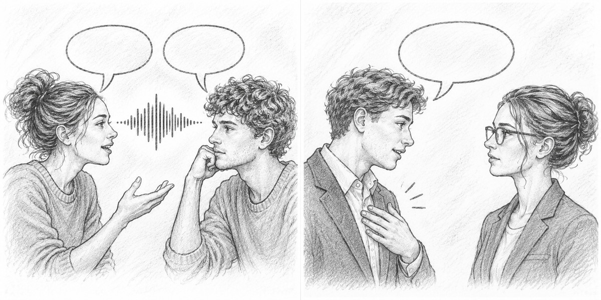

```{r}
#| label: setup
#| include: false

# install.packages(c("tidyverse", "lme4", "here", "patchwork", "performance", "see",
#                    "ggeffects"))
library(tidyverse)
library(lme4)
library(here)       # rutas desde la raiz del proyecto (exercises.Rproj)
library(patchwork)  # para juntar paneles en las figuras ilustrativas

options(scipen = 999, width = 80)  # emparejado con body-width: 780px
options(pillar.sigfig = 5)  # tibbles con 5 cifras significativas

# Estetica comun de las figuras ilustrativas (solo presentacion)
theme_tut <- theme_classic(base_size = 11) +
  theme(plot.title = element_text(size = 11, face = "bold"),
        plot.title.position = "plot")
```

Este documento sigue el segundo tutorial de Winter (2013), *Linear models and linear mixed effects models in R with linguistic applications* (arXiv:1308.5499). El primer tutorial, el modelo lineal y sus supuestos, está en un documento aparte. Los conceptos (efectos fijos y aleatorios, interceptos y pendientes variables) están en la [introducción conceptual](day1_02_intro_conceptual_lmm.html).

# El modelo lineal mixto

> El ejemplo de Winter: el tono de voz y la cortesía (Winter y Grawunder, 2012). Seis hablantes, tres mujeres y tres hombres, respondieron en registro cortés y en registro informal en siete escenarios distintos, como pedir un favor o disculparse por llegar tarde. De cada respuesta se midió el tono medio de voz, en Hz. La pregunta: ¿baja el tono al hablar con cortesía?

{fig-alt="Dibujo: la misma conversación en registro informal y en registro cortés." width=600 fig-align="center"}

## Conocer los datos

```{r}
#| label: t2-data

# En el archivo, el tono de voz (Hz) se llama frequency: lo renombramos a
# pitch, como en el tutorial 1
politeness <- read_csv(
  file = here("exercises", "data", "raw_data", "politeness_data.csv"),
  show_col_types = FALSE
) |>
  rename(pitch = frequency)
print(politeness)
```

::: {.column-margin}
Las primeras filas son de la participante F1: sus respuestas cortés y informal en los escenarios 1 a 5. Cada fila es una respuesta, con el hablante, su género, el escenario, la actitud y el tono en Hz.
:::

```{r}
#| label: t2-counts

xtabs(formula = ~ subject + scenario, data = politeness)
```

::: {.column-margin}
El cruce de hablante y escenario: cada hablante pasa por los siete escenarios y cada escenario por los seis hablantes. Cada celda tiene dos respuestas, una cortés y una informal. Hablante y escenario están **cruzados**, no anidados.
:::

Tono por actitud y género. Lo cortés es más grave en los dos géneros; la diferencia entre géneros es mucho mayor que la de actitud.

```{r}
#| label: t2-boxplot
#| echo: false
#| fig-width: 7
#| fig-height: 4.5

ggplot(data = politeness,
       mapping = aes(x = gender, y = pitch, colour = attitude)) +
  # Cajas sin puntos atipicos: debajo se dibujan todas las respuestas
  geom_boxplot(outlier.shape = NA, fill = "white",
               position = position_dodge(width = 0.8)) +
  # Una respuesta por punto, desplazada un poco para que no se solapen
  geom_point(position = position_jitterdodge(jitter.width = 0.15,
                                             dodge.width = 0.8,
                                             seed = 1),
             size = 1.6, alpha = 0.8) +
  scale_colour_viridis_d(end = 0.8,
                         labels = c("informal", "cort\u00e9s")) +
  scale_x_discrete(labels = c("Mujeres", "Hombres")) +
  labs(x = NULL, y = "Tono (Hz)", colour = NULL) +
  theme_classic()
```

## Interceptos variables por hablante y por escenario

```{r}
#| label: t2-baseline-subject
#| echo: false
#| fig-width: 8
#| fig-height: 3

# La figura de Winter: tono por hablante. Puntos: cada respuesta; raya: la media.
politeness |>
  filter(!is.na(pitch)) |>
  ggplot(mapping = aes(x = subject, y = pitch)) +
  geom_point(size = 1.6, colour = "grey55", alpha = 0.8) +
  stat_summary(fun = mean, geom = "crossbar", width = 0.5,
               colour = "grey20", linewidth = 0.4) +
  labs(x = "Hablante", y = "Tono (Hz)") +
  theme_tut
```

::: {.column-margin}
Cada punto es una respuesta y la raya, la media de cada hablante. Los hombres son más graves que las mujeres, y dentro de cada sexo cada hablante tiene su propio nivel.
:::

```{r}
#| label: t2-baseline-scenario
#| echo: false
#| fig-width: 8
#| fig-height: 3

# La figura de Winter: tono por escenario (item).
politeness |>
  filter(!is.na(pitch)) |>
  ggplot(mapping = aes(x = factor(scenario), y = pitch)) +
  geom_point(size = 1.6, colour = "grey55", alpha = 0.8) +
  stat_summary(fun = mean, geom = "crossbar", width = 0.5,
               colour = "grey20", linewidth = 0.4) +
  labs(x = "Escenario", y = "Tono (Hz)") +
  theme_tut
```

::: {.column-margin}
Lo mismo por escenario. La variación entre escenarios es menor que entre hablantes, pero existe.
:::

`pitch ~ attitude + (1|subject) + (1|scenario)`

`(1 | subject)`: cada hablante tiene su propio tono de base. `(1 | scenario)`: cada escenario tiene su propio tono de base.

```{r}
#| label: t2-model-intercepts

politeness_model <- lmer(
  formula = pitch ~ attitude + (1 | subject) + (1 | scenario),
  data = politeness
)
summary(politeness_model)
```

::: {.column-margin}
Qué mirar en la salida, en este orden:

- **Random effects:** la desviación típica entre hablantes (grande: hay hombres y mujeres) y entre escenarios (pequeña), y la residual, lo que queda sin explicar. Son las tres fuentes de variación del modelo.
- **Fixed effects:** `(Intercept)` es el tono medio en la condición de referencia, `inf` por orden alfabético. `attitudepol` es cuánto baja el tono al ser cortés, unos 20 Hz. Al lado, su error típico y el valor t, sin p-valor: `lme4` no lo da.

El intercepto, 202.6 Hz, no es el tono de nadie: está a medio camino entre hombres y mujeres, porque el modelo no sabe que hay dos sexos. La analogía de la granja: con doce gallinas y doce vacas, la media de patas por animal es tres.
:::

## Añadir el género como efecto fijo

El género explica buena parte de la variación entre hablantes. Al meterlo como efecto fijo, la desviación típica del intercepto por hablante baja mucho: esa varianza se "mueve" del efecto aleatorio al fijo. Y el intercepto pasa a ser el tono de las mujeres en la condición informal.

`pitch ~ attitude + gender + (1|subject) + (1|scenario)`

```{r}
#| label: t2-model-gender

politeness_model_gender <- lmer(
  formula = pitch ~ attitude + gender +
    (1 | subject) + (1 | scenario),
  data = politeness
)
summary(politeness_model_gender)
```

::: {.column-margin}
**La salida, en la ecuación.**

```{r}
#| label: t2-output-equation
#| echo: false
#| fig-width: 4.2
#| fig-height: 3.2

# La ecuacion del modelo final con los numeros de summary(); en rojo, de que
# fila de la salida sale cada numero (solo presentacion). j es el hablante y
# k el escenario.
red <- "#C0392B"
fixed <- fixef(politeness_model_gender)
sds <- as.data.frame(VarCorr(politeness_model_gender))
sd_of <- function(group) sds$sdcor[sds$grp == group]
num <- function(v) sprintf("%.2f", abs(v))
sign_of <- function(v) if (v < 0) "−" else "+"
# Cada pieza de texto: cursiva o no, tamano relativo (los subindices van
# mas pequenos y mas bajos) y separacion con la pieza anterior
piece <- function(label, italic = FALSE, sub = FALSE, gap = 0.06) {
  tibble(label = label, face = if (italic) "italic" else "plain",
         mult = if (sub) 0.62 else 1, dy = if (sub) -0.04 else 0, gap = gap)
}
with_sub <- function(letter, index) {
  bind_rows(piece(letter, italic = TRUE), piece(index, italic = TRUE, sub = TRUE, gap = 0))
}
normal <- function(sd_txt) {
  bind_rows(piece("~"), piece("N(0,"), piece(paste0(sd_txt, "²"), gap = 0.05),
            piece(")", gap = 0))
}
first_gap0 <- function(row) mutate(row, gap = replace(gap, 1, 0))
row_1 <- bind_rows(piece("y", italic = TRUE, gap = 0), piece("="), piece(num(fixed[1])),
                   piece("+"), with_sub("u", "j"), piece("+"), with_sub("w", "k"))
row_2 <- bind_rows(piece(sign_of(fixed[2]), gap = 0), piece(num(fixed[2])), piece("·"),
                   piece("cortés"))
row_3 <- bind_rows(piece(sign_of(fixed[3]), gap = 0), piece(num(fixed[3])), piece("·"),
                   piece("hombre"), piece("+"), piece("ε", italic = TRUE))
row_u <- bind_rows(first_gap0(with_sub("u", "j")), normal(num(sd_of("subject"))))
row_w <- bind_rows(first_gap0(with_sub("w", "k")), normal(num(sd_of("scenario"))))
row_e <- bind_rows(piece("ε", italic = TRUE, gap = 0), normal(num(sd_of("Residual"))))
# Anchura de cada pieza, medida en un dispositivo auxiliar, para colocarlas
tmp_png <- tempfile(fileext = ".png")
png(filename = tmp_png, width = 4.2, height = 3.2, units = "in", res = 72)
place <- function(row, y, size = 4.6, x0 = 0.05) {
  row |>
    mutate(size = size * mult,
           width = map_dbl(seq_len(n()), \(i) {
             strwidth(label[i], units = "inches", cex = size[i] * .pt / 12,
                      family = "serif", font = if (face[i] == "italic") 3 else 1)
           }),
           x_left = x0 + cumsum(c(0, head(width, -1))) + cumsum(gap) - gap[1],
           y = y + dy)
}
y_rows <- c(2.95, 2.55, 2.15, 1.4, 0.85, 0.3)
rows <- list(place(row_1, y_rows[1]), place(row_2, y_rows[2], x0 = 0.3),
             place(row_3, y_rows[3], x0 = 0.3),
             place(row_u, y_rows[4]), place(row_w, y_rows[5]), place(row_e, y_rows[6]))
invisible(dev.off())
x_lab <- 2.75
labels_out <- tibble(
  y = y_rows,
  label = c("(Intercept)", "attitudepol", "genderM", "(Intercept)", "(Intercept)",
            "Residual")
)
groups_out <- tibble(y = c(y_rows[4], y_rows[5]) + 0.27, label = c("subject", "scenario"))
ggplot(data = bind_rows(rows)) +
  geom_text(mapping = aes(x = x_left, y = y, label = label, fontface = face, size = size),
            hjust = 0, family = "serif") +
  scale_size_identity() +
  annotate("segment", x = x_lab - 0.14, xend = x_lab - 0.05, y = labels_out$y,
           yend = labels_out$y, colour = red, linewidth = 0.45) +
  annotate("text", x = x_lab, y = labels_out$y, label = labels_out$label, hjust = 0,
           colour = red, family = "mono", size = 3.2) +
  annotate("text", x = x_lab, y = groups_out$y, label = groups_out$label, hjust = 0,
           colour = "grey45", family = "mono", size = 3.2) +
  scale_x_continuous(limits = c(0, 4.2), expand = c(0, 0)) +
  scale_y_continuous(limits = c(0.1, 3.15), expand = c(0, 0)) +
  coord_cartesian(clip = "off") +
  theme_void() +
  theme(plot.margin = margin(0, 0, 0, 0))
```

$j$ es el hablante y $k$ el escenario: $u_j$ es la desviación de cada hablante y $w_k$, la de cada escenario. cortés = 1 en las respuestas corteses y hombre = 1 en los hablantes hombres.
:::

La desviación típica por hablante en los dos modelos:

```{r}
#| label: t2-varcorr

VarCorr(politeness_model)
VarCorr(politeness_model_gender)
```

Las dos variables a la vez: el tono que predice el modelo para cada género y cada actitud, con su intervalo de confianza del 95 %.

```{r}
#| label: t2-ggeffects
#| fig-width: 6
#| fig-height: 4

# Predicciones del modelo para cada combinacion de genero y actitud
gender_predictions <- ggeffects::ggpredict(
  model = politeness_model_gender,
  terms = c("gender", "attitude")
)
plot(gender_predictions)
```

## El p-valor de la actitud: test de razón de verosimilitudes (*likelihood ratio test*)

Se compara el modelo con actitud contra el mismo modelo sin ella. Los dos se ajustan con `REML = FALSE`, máxima verosimilitud completa, que es lo que exige la comparación por verosimilitud. `anova()` hace el test: chi cuadrado con 1 grado de libertad, la diferencia en número de parámetros.

Modelo nulo:

`pitch ~ gender + (1|subject) + (1|scenario)`

Modelo completo:

`pitch ~ attitude + gender + (1|subject) + (1|scenario)`

```{r}
#| label: t2-lrt-intercepts

politeness_null_ml <- lmer(
  formula = pitch ~ gender + (1 | subject) + (1 | scenario),
  data = politeness, REML = FALSE
)
politeness_model_ml <- lmer(
  formula = pitch ~ attitude + gender +
    (1 | subject) + (1 | scenario),
  data = politeness, REML = FALSE
)
anova(politeness_null_ml, politeness_model_ml)
```

::: {.callout-note title="Para comparar dos modelos con anova()"}
- Los dos modelos se ajustan con `REML = FALSE`.
- La estructura aleatoria tiene que ser idéntica en los dos: lo único que cambia es el efecto fijo que se contrasta.
:::

Cómo lo reporta Winter: "la cortesía afectó al tono (chi cuadrado(1) = 11.62, p = 0.00065), bajándolo unos 19.7 Hz ± 5.6 (errores típicos)". El tamaño del efecto sale de los coeficientes del modelo completo:

```{r}
#| label: t2-coef-summary

coef(summary(politeness_model_ml))
```

::: {.column-margin}
El género se queda en los dos modelos: es la variable de control, y la actitud es la que se contrasta. Una interacción se contrasta igual: `attitude * gender` frente a `attitude + gender`.
:::

## Pendientes variables

Es poco realista que la cortesía afecte igual a todo el mundo y en todos los escenarios. `(1 + attitude | subject)` deja que cada hablante tenga su propio intercepto y su propia pendiente de actitud; igual para el escenario. Winter lo llama "super crucial" y dice que el modelo debe incluir las pendientes variables de todo efecto fijo que importe para la interpretación.

`pitch ~ attitude + gender + (1 + attitude|subject) + (1 + attitude|scenario)`

```{r}
#| label: t2-model-slopes
#| message: true

politeness_model_slopes <- lmer(
  formula = pitch ~ attitude + gender +
    (1 + attitude | subject) + (1 + attitude | scenario),
  data = politeness, REML = FALSE
)
summary(politeness_model_slopes)
```

```{r}
#| label: t2-degenerate-numbers
#| include: false

# La correlacion y la desviacion tipica de la pendiente por hablante
vc_slopes <- as.data.frame(VarCorr(politeness_model_slopes))
subject_corr <- vc_slopes$sdcor[vc_slopes$grp == "subject" & !is.na(vc_slopes$var2)]
subject_slope_sd <- vc_slopes$sdcor[vc_slopes$grp == "subject" &
                                     vc_slopes$var1 == "attitudepol" &
                                     is.na(vc_slopes$var2)]
```

El aviso `boundary (singular) fit` dice que el modelo es **degenerado**: alguna estimación de la parte aleatoria ha quedado en el límite de lo posible. En la salida se ve en *Random effects*: la correlación entre el intercepto y la pendiente por hablante es `r sprintf("%.2f", subject_corr)`, y la desviación típica de esa pendiente, `r sprintf("%.2f", subject_slope_sd)` Hz, es casi cero. Con 6 hablantes, los datos no dan para estimar una pendiente distinta para cada uno.

```{r}
#| label: t2-degenerate

isSingular(politeness_model_slopes)
```

::: {.column-margin}
El Día 2 usaremos `rePCA()` para simplificar la estructura aleatoria.
:::

## Supuestos del modelo mixto

Los mismos supuestos que el modelo lineal, comprobados igual. `check_model()` los enseña todos de una vez y, para un modelo mixto, añade un panel con la normalidad de los efectos aleatorios: los interceptos y pendientes por hablante y por escenario también se asumen normales.

```{r}
#| label: t2-check-model
#| fig-width: 10
#| fig-height: 11

performance::check_model(politeness_model_slopes)
```

La independencia merece una palabra aparte. Pasamos al modelo mixto justamente para resolverla, pero un modelo mixto también puede violarla si le falta un efecto fijo o aleatorio importante. Un modelo sin `(1 | subject)` no sabría que hay varias respuestas por hablante, y volveríamos a la pseudorreplicación del Tutorial 1.

## Cómo redactarlo

El texto tiene que permitir reproducir el análisis: todos los efectos fijos y aleatorios, si hay interceptos o pendientes variables, cómo se obtuvieron los p-valores, que se comprobaron los supuestos, y las versiones de R y de `lme4`. Para el análisis de este tutorial, así se redactaría en inglés:

```{r}
#| label: t2-writeup-numbers
#| include: false

# Los numeros del parrafo, sacados de los modelos para no copiarlos a mano
lrt <- anova(politeness_null_ml, politeness_model_ml)
attitude_row <- coef(summary(politeness_model_gender))["attitudepol", ]
n_speakers <- ngrps(politeness_model_ml)[["subject"]]
n_scenarios <- ngrps(politeness_model_ml)[["scenario"]]
p_text <- if (lrt$`Pr(>Chisq)`[2] < 0.001) "< .001" else
  paste("=", sub("^0", "", sprintf("%.3f", lrt$`Pr(>Chisq)`[2])))
```

> We analysed voice pitch (Hz) with a linear mixed-effects model in R (version `r paste(R.version$major, R.version$minor, sep = ".")`; R Core Team, `r R.version$year`) using the lme4 package (version `r packageVersion("lme4")`; Bates et al., 2015). The data comprised `r nobs(politeness_model_ml)` responses from `r n_speakers` speakers (three female, three male) across `r n_scenarios` scenarios. Politeness (informal vs. polite) and gender were entered as fixed effects without an interaction, with treatment coding and informal speech and female speakers as reference levels. A model that also included by-speaker and by-scenario random slopes for politeness yielded a singular fit, so the final model included random intercepts for speakers and scenarios only. Visual inspection of residual plots revealed no obvious departures from homoscedasticity or normality. The effect of politeness was tested with a likelihood-ratio test between models fitted by maximum likelihood, comparing the full model with a model without politeness and with the same random-effects structure; the estimate and its standard error come from the model fitted by restricted maximum likelihood (REML). Polite speech lowered pitch by `r sprintf("%.1f", abs(attitude_row[["Estimate"]]))` Hz (*SE* = `r sprintf("%.1f", attitude_row[["Std. Error"]])`), χ²(`r lrt$Df[2]`) = `r sprintf("%.2f", lrt$Chisq[2])`, *p* `r p_text`.

Y citar a quienes hicieron las herramientas:

```{r}
#| label: t2-citation

citation("lme4")
```

# Referencias

Bates, D., Mächler, M., Bolker, B., & Walker, S. (2015). Fitting linear mixed-effects models using lme4. *Journal of Statistical Software, 67*(1), 1–48. <https://doi.org/10.18637/jss.v067.i01>

Winter, B. (2013). *Linear models and linear mixed effects models in R with linguistic applications*. arXiv:1308.5499. <https://arxiv.org/abs/1308.5499>

Winter, B., & Grawunder, S. (2012). The phonetic profile of Korean formal and informal speech registers. *Journal of Phonetics, 40*(6), 808–815. <https://doi.org/10.1016/j.wocn.2012.08.006>

# Session information

```{r}
#| label: session-info
#| code-fold: true

sessionInfo()
```
